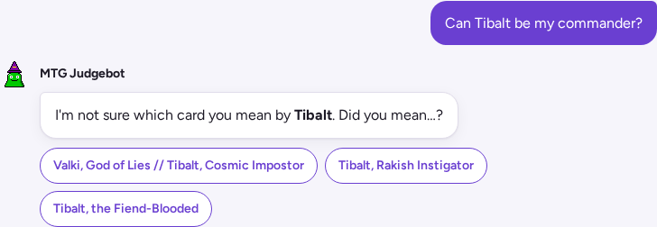
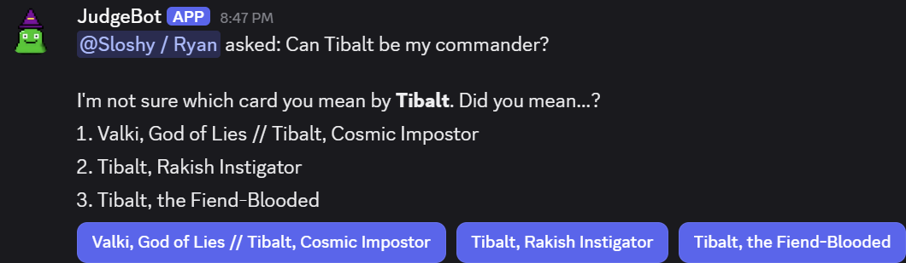

The following are sample answers given by the bot so you can see how it works without running it yourself.

A nickname that could mean several cards gets a question back instead of a guess:

On Discord the answer arrives as a message, with the citations in an embed and the rating
buttons beneath it. The "did you mean…?" choices are buttons too.

## Where these come from

The five answers below are copied from `eval/published/v2-default-r1.json`, the 2026-10-22
run of the [gold evaluation set](../../how-it-works/evaluation/) on the default
configuration (`claude-opus-5-5` at medium effort on both stages, Voyage embeddings). The
run file holds all 22.

Nothing is edited except the one note on the last sample. Each question is as the gold
set asks it, typos and all. The answer, citations, time and cost are as the run recorded
them.

Every quote was checked verbatim against its source before the answer was accepted, and
each is shown whole. Rule numbers link to the Yawgatog mirror, as they do in a real
answer.

## Layers: Humility and Opalescence

**Asked**

> ok classic one. I have [[Humility]] out and my opponent drops [[Opalescence]]. what are Humility and Opalescence now?? are all my creatures still 1/1? does the answer change if Opalescence was out first?

**Answered**

> Your regular creatures stay 1/1 with no abilities either way. Only the enchantments change, and the result depends on timestamps.
>
> **Humility out first, Opalescence later (your case):**
> - **Opalescence** is not a creature. It affects only "Each other non-Aura enchantment", so it doesn't animate itself.
> - **Humility** becomes a 4/4 enchantment creature with no abilities.
> - Your other creatures are 1/1 with no abilities. Opalescence doesn't touch non-enchantments.
>
> Here's how the layers work it out:
> - Layer 4: Opalescence makes Humility a creature.
> - Layer 6: Humility's effect removes all creature abilities, including Humility's own. Its effect still finishes applying anyway, because per `613.6` an effect that has started to apply "will continue to be applied to the same set of objects in each other applicable layer" even if the ability is removed partway through.
> - Layer 7b: Both effects set base P/T, so they apply in timestamp order (`613.4b`, `613.7`). Humility's is earlier, so it makes Humility 1/1 first. Opalescence's later effect then sets it to its mana value, 4/4.
>
> **Opalescence out first, Humility later:** Layers 4 and 6 work out the same. In 7b, Opalescence's effect applies first and Humility's later effect overrides it. So Humility is a 1/1 with no abilities, like every other creature. Opalescence is still not a creature.
>
> The Scryfall ruling on both cards walks through exactly these two orders: Opalescence first gives 4/4 then 1/1; Humility first gives 1/1 then 4/4.

- [**613.6**](https://yawgatog.com/resources/magic-rules/#R6136) “If an effect starts to apply in one layer and/or sublayer, it will continue to be applied to the same set of objects in each other applicable layer and/or sublayer, even if the ability generating the effect is removed during this process.”
- [**613.4b**](https://yawgatog.com/resources/magic-rules/#R6134b) “Layer 7b: Effects that set power and/or toughness to a specific number or value are applied. Effects that refer to the base power and/or toughness of a creature apply in this layer.”
- [**613.7**](https://yawgatog.com/resources/magic-rules/#R6137) “An effect with an earlier timestamp is applied before an effect with a later timestamp.”
- **Ruling — Humility** “Layer 7b: Humility becomes 1/1 and Worship becomes 1/1 (Humility). Humility becomes 4/4 and Worship becomes 4/4 (Opalescence).”
- **Ruling — Opalescence** “Does not animate itself.”
- **Oracle text — Opalescence** “Each other non-Aura enchantment is a creature in addition to its other types and has base power and base toughness each equal to its mana value.”

Confidence: High · CR 2026-09-25 · 20 s · 2 model calls · $0.10

## Trample and deathtouch, and a misremembered card

**Asked**

> I attack with a 5/5 trample that also has deathtouch (Questing Beast) and they block with a 4/4. how much can I trample over? my opponent says I have to assign 4 to the blocker first

**Answered**

> Your opponent is wrong. You only have to assign **1** damage to the 4/4. The other **4** can go to the player, which means you trample over 4.
>
> One correction first: **Questing Beast**'s current Oracle text is "Vigilance, deathtouch, haste". It's a 4/4 and doesn't have trample on its own. I'm assuming something else is making it a 5/5 with trample.
>
> With trample, you have to assign lethal damage to every blocker before any excess can go to the player, per `702.19b`. Deathtouch changes what counts as lethal. Under `702.2c`, any nonzero amount of combat damage from a deathtouch source counts as lethal damage when working out excess. So 1 damage covers the 4/4, and the remaining 4 can be split however you like between the blocker and the player. That 1 damage also destroys the blocker as a state-based action, per `702.2b`.
>
> Because the 4 damage to the player is combat damage dealt to an opponent, Questing Beast's last ability also triggers. It deals that much damage to a target planeswalker that player controls, if they have one.

- [**702.2c**](https://yawgatog.com/resources/magic-rules/#R7022c) “Any nonzero amount of combat damage assigned to a creature by a source with deathtouch is considered to be lethal damage for the purposes of determining if excess damage is being dealt.”
- [**702.19b**](https://yawgatog.com/resources/magic-rules/#R70219b) “Once all those blocking creatures are assigned lethal damage, any excess damage is assigned as its controller chooses among those blocking creatures and the player, planeswalker, or battle the creature is attacking.”
- [**702.2b**](https://yawgatog.com/resources/magic-rules/#R7022b) “A creature with toughness greater than 0 that’s been dealt damage by a source with deathtouch since the last time state-based actions were checked is destroyed as a state-based action.”
- **Oracle text — Questing Beast** “Vigilance, deathtouch, haste”

Confidence: High · CR 2026-09-25 · 12 s · 3 model calls · $0.09

## An old printing against the current Oracle text

**Asked**

> old school question. my Waylay (Urza's Saga printing) says 'at end of turn, remove them from the game'. so I cast it during my opponent's end step, the knights survive since the end step already started, and I get to swing with them on my turn right? classic waylay trick

**Answered**

> No. The trick doesn't work under current Oracle wording. **Waylay** has been errata'd and now reads: "Create three 2/2 white Knight creature tokens. Exile them at the beginning of the next cleanup step."
>
> The old "at end of turn" wording is what made the trick work. Per `513.1a`, cards printed with "at end of turn" have received Oracle errata. Waylay's errata points its delayed trigger at the **cleanup step**, not the end step. If you cast it during your opponent's end step, the "next cleanup step" is the one that comes right after it in that same turn.
>
> The "step doesn't back up" rule in `513.2` only covers abilities that trigger "at the beginning of the next end step" and are created during the end step. It doesn't help here. When that cleanup step happens, per `514.3a` the game checks for triggered abilities, "including those that trigger 'at the beginning of the next cleanup step'". The exile trigger goes on the stack and the Knights are exiled before your turn starts.
>
> Waylay is still a fine combat trick or end-of-turn blocker against attacks during your opponent's turn, but the Knights won't be around to attack on your turn.

- **Oracle text — Waylay** “Exile them at the beginning of the next cleanup step.”
- [**513.1a**](https://yawgatog.com/resources/magic-rules/#R5131a) “Cards that were printed with that text have received errata in the Oracle card reference”
- [**513.2**](https://yawgatog.com/resources/magic-rules/#R5132) “Likewise, if a delayed triggered ability that triggers “at the beginning of the next end step” is created during this step, that ability won’t trigger until the next turn’s end step.”
- [**514.3a**](https://yawgatog.com/resources/magic-rules/#R5143a) “including those that trigger “at the beginning of the next cleanup step””

Confidence: High · CR 2026-09-25 · 13 s · 2 model calls · $0.07

## Commander: colour identity and the command zone

**Asked**

> commander q: my commander is [[Kenrith, the Returned King]]. two things: 1) can I run Nicol Bolas, the Ravager since Kenrith's text mentions all 5 colors? and 2) someone bounced Kenrith to my hand with Unsummon - does he go to the command zone or is that only for graveyard/exile?

**Answered**

> 1) Yes, you can run **Nicol Bolas, the Ravager**. 2) Yes, you can send **Kenrith** to the command zone when he's bounced. It's your choice, and it works for hand and library too, not just graveyard and exile.
>
> **1)** Color identity counts the mana symbols in a card's mana cost *and* its rules text (903.4). Kenrith costs {4}{W}, and his abilities include "{R}: All creatures gain trample and haste", "{1}{G}: Put a +1/+1 counter", "{3}{U}: Target player draws a card" and "{4}{B}: Put target creature card from a graveyard onto the battlefield". That makes his color identity all five colors. Bolas's identity is blue, black and red. Its back face also counts (903.4d), and it adds nothing outside those three colors. Per 903.5c, a card is legal if every color in its identity is in your commander's identity. Bolas passes.
>
> **2)** Per 903.9b, if a commander would be put into its owner's hand or library from anywhere, the owner may put it into the command zone instead. This is a replacement effect, so when **Unsummon** resolves you choose right then. You can keep Kenrith in your hand and recast him from there with no tax, or put him in the command zone and pay commander tax when you cast him from there. Graveyard and exile work differently: there it's a state-based action that lets you move him afterward (903.9a).

- [**903.4**](https://yawgatog.com/resources/magic-rules/#R9034) “The color identity of a card is the color or colors of any mana symbols in that card’s mana cost or rules text”
- [**903.5c**](https://yawgatog.com/resources/magic-rules/#R9035c) “A card can be included in a Commander deck only if every color in its color identity is also found in the color identity of the deck’s commander.”
- [**903.4d**](https://yawgatog.com/resources/magic-rules/#R9034d) “The back face of a double-faced card (see rule 712) is included when determining a card’s color identity.”
- [**903.9b**](https://yawgatog.com/resources/magic-rules/#R9039b) “If a commander would be put into its owner’s hand or library from anywhere, its owner may put it into the command zone instead.”
- [**903.9a**](https://yawgatog.com/resources/magic-rules/#R9039a) “If a commander is in a graveyard or in exile and that object was put into that zone since the last time state-based actions were checked, its owner may put it into the command zone.”
- **Oracle text — Kenrith, the Returned King** “{3}{U}: Target player draws a card.”

Confidence: High · CR 2026-09-25 · 14 s · 2 model calls · $0.10

## Out of scope: a price question

**Asked**

> how much is a snappy going for these days? thinking about picking up a playset

**Answered**

> I only answer Comprehensive Rules and Commander rules questions. Tournament policy (MTR/IPG) and questions that aren't about the rules are out of my scope: for policy, see the Magic Tournament Rules or ask a tournament judge.

(The run file records this outcome as `OutOfScope`. The sentence above is what Discord
and the web app show for it.)

Declined after the classification call, before synthesis · 2 s · 1 model call · $0.004
